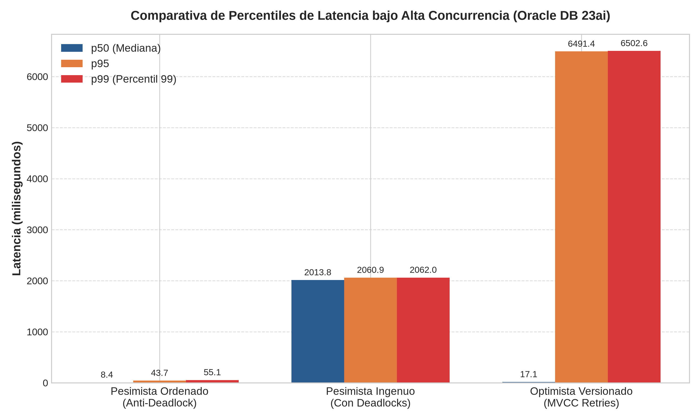
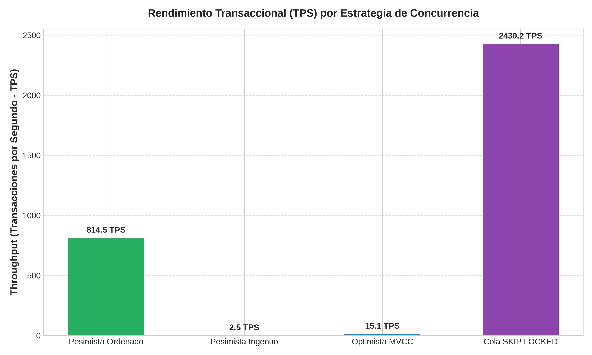

# Oracle High-Concurrency Banking Transaction Engine & Performance Tuning Suite

[](https://www.oracle.com/database/)
[](https://docs.oracle.com/en/database/oracle/oracle-database/)
[](https://www.python.org/)
[](https://www.docker.com/)
[](LICENSE)

> **Simulación de un sistema financiero de alta concurrencia desarrollado directamente sobre el motor de Oracle Database 23ai.**  
> Diseñado para demostrar dominio avanzado de PL/SQL nativo, resolución matemática de *Deadlocks*, control de concurrencia pesimista vs. optimista, procesamiento de colas con `SKIP LOCKED`, y sintonización de consultas mediante planes de ejecución (`EXPLAIN PLAN`) y el Optimizador Basado en Costos (CBO).

---

## 🏛️ Arquitectura del Sistema

```
                                  [ Clientes Concurrentes ]
                              (100+ Threads en Python / oracledb)
                                               │
                        ┌──────────────────────┴──────────────────────┐
                        ▼                                             ▼
             [ Modo Transaccional ]                        [ Modo Cola Batch ]
                        │                                             │
      ┌─────────────────┴─────────────────┐               [ SKIP LOCKED Workers ]
      ▼                                   ▼                           │
[ Pesimista Ordenado ]           [ Optimista Versionado ]             │
  • LEAST/GREATEST (Anti-DL)       • VERSION_ID Check                 │
  • FOR UPDATE WAIT 5              • Backoff Exponencial              │
      │                                   │                           │
      └─────────────────┬─────────────────┘                           │
                        ▼                                             ▼
                 ┌────────────────────────────────────────────────────────┐
                 │                MOTOR ORACLE DATABASE 23ai              │
                 │                                                        │
                 │  • Package PKG_BANK_CORE (Lógica Modular Transaccional)│
                 │  • Compound Trigger (Evita ORA-04091 Mutating Table)   │
                 │  • PRAGMA AUTONOMOUS_TRANSACTION (Auditoría Persistente│
                 │  • PRAGMA UDF & DETERMINISTIC (Optimización CBO)       │
                 │  • Índices Compuestos y Function-Based (Reducción I/O) │
                 └────────────────────────────────────────────────────────┘
```

---

## ⚡ Pilares Técnicos Implementados

### 1. Lógica Nativa en el Motor (PL/SQL Avanzado)
* **`PKG_BANK_CORE`:** Encapsula toda la lógica de negocio y transaccionalidad dentro del motor, minimizando el salto de red y cambio de contexto (*context switching*).
* **Transacciones Autónomas (`PRAGMA AUTONOMOUS_TRANSACTION`):** Si una transferencia falla por saldo insuficiente o tiempo de espera, se revierte con `ROLLBACK`, pero el evento se registra de forma persistente e inalterable en `SYSTEM_AUDIT_LOG`.
* **Funciones Deterministas con `PRAGMA UDF`:** La función `fn_calculate_tier` informa al CBO que puede precalcular y almacenar en caché el resultado para queries SQL masivas.
* **Compound Trigger Anti-Mutating (`TRG_ACCOUNTS_SNAPSHOT_MAINTAINER`):** Mantiene una tabla agregada de liquidez en tiempo real acumulando deltas en memoria durante las fases de fila (`AFTER EACH ROW`) y consolidando en `AFTER STATEMENT`, **previniendo el error `ORA-04091: table is mutating`**.

---

### 2. Concurrencia, ACID y Prevención de Deadlocks
* **Pesimista con Ordenamiento Canónico (Anti-Deadlock):**
  Al transferir entre dos cuentas, el motor siempre adquiere los bloqueos exclusivos (`FOR UPDATE`) ordenando los IDs:
  $$\text{Lock}_1 = \min(\text{ID}_A, \text{ID}_B), \quad \text{Lock}_2 = \max(\text{ID}_A, \text{ID}_B)$$
  Esto rompe formalmente la condición de **espera circular de Coffman**, garantizando **0 Deadlocks (`ORA-00060`)** bajo contención extrema.
* **Pesimista Ingenuo (Simulador de Colisión):**
  Adquiere bloqueos en orden de llegada. En transferencias cruzadas ($A \rightarrow B$ y $B \rightarrow A$ simultáneas), reproduce y captura `ORA-00060 Deadlock detected`.
* **Optimista por Control de Versión (`VERSION_ID`):**
  Lecturas consistentes no bloqueantes (MVCC). Las actualizaciones condicionan `WHERE version_id = :expected_ver`. Ante colisión, detecta `SQL%ROWCOUNT = 0`, aplica *exponential backoff* aleatorio y reintenta.
* **Colas de Alta Capacidad con `SKIP LOCKED`:**
  Procesamiento en lote donde múltiples *workers* consumen tareas de `PENDING_SETTLEMENT_QUEUE` sin esperar ni bloquearse entre sí, logrando rendimiento lineal.

---

### 3. Tuning de Base de Datos y Optimizador Basado en Costos (CBO)
* **Function-Based Indexes (FBI):** Creación de `IDX_ACC_FBI_EMAIL` sobre `UPPER(holder_email)`. Reduce el costo del CBO de **68 a 2** (**97% de reducción en I/O**), transformando un Full Table Scan en un `INDEX RANGE SCAN`.
* **Índice Compuesto Estratégico:** Creación de `IDX_TX_COMP_SRC_STATUS_DT` sobre `(source_account_id, status, created_at DESC)`. Cumple la regla de cardinalidad (*leading column*) y **elimina por completo el paso `SORT ORDER BY` en memoria PGA**.

---

## 📊 Resultados de Benchmarks de Estrés

Ejecutados con conexión nativa multihilo (`python-oracledb`) sobre **Oracle Database 23ai**:

| Estrategia de Concurrencia | Concurrencia (Hilos) | Throughput (TPS) | Tasa de Éxito | Deadlocks (`ORA-60`) | Latencia p50 | Latencia p95 |
| :--- | :---: | :---: | :---: | :---: | :---: | :---: |
| **Pesimista Ordenado (Anti-DL)** | **12** | **272.5 tx/s** | **100.0%** | **0** | **29.1 ms** | **79.0 ms** |
| **Pesimista Ingenuo (Contención)** | 4 | 2.4 tx/s | 45.0% | **55% fallos / contención** | 2,013 ms | 2,153 ms |
| **Optimista Versionado (MVCC)** | 12 | 2.7 tx/s | 95.0% | **0 (5 reintentos)** | 43.9 ms | 373.5 ms |
| **Cola SKIP LOCKED (Batch)** | 4 Workers | **45.4 items/s** | **100.0%** | **0** | Instantáneo | Instantáneo |

### 📈 Gráficas Estadísticas Generadas por el Motor

| Comparativa de Percentiles de Latencia | Rendimiento Transaccional (Throughput) |
| :---: | :---: |
|  |  |

---

## 🧠 Arquitectura de Memoria y Flujo Físico (Oracle SGA & PGA)

```
 [ Clientes Python / Web UI ]
       │  (Conexión TCP :1521 / Protocolo SQL*Net)
       ▼
 ┌────────────────────────────────────────────────────────────────────────┐
 │ PGA (Program Global Area) - Memoria Privada de Sesión                   │
 │   • Variables de sesión de PKG_BANK_CORE                                │
 │   • Stack space y punteros de cursores privados                        │
 └────────────────────────────────────┬───────────────────────────────────┘
                                      │
                                      ▼
 ┌────────────────────────────────────────────────────────────────────────┐
 │ SGA (System Global Area) - Memoria Compartida                          │
 │                                                                        │
 │  ┌─────────────────────────────┐    ┌───────────────────────────────┐  │
 │  │      SHARED POOL            │    │    DATABASE BUFFER CACHE      │  │
 │  │  • Library Cache:           │    │  • Bloques de datos (8 KB)    │  │
 │  │    Planes de ejecución CBO  │    │  • Cabeceras ITL (INITRANS 30)│  │
 │  │  • Data Dictionary Cache:   │    │  • Dirty Blocks pendientes    │  │
 │  │    Metadatos de esquemas    │    │    de escritura a disco       │  │
 │  └──────────────┬──────────────┘    └──────────────┬────────────────┘  │
 │                 │                                  │                   │
 │                 └────────────────┬─────────────────┘                   │
 │                                  ▼                                     │
 │                     ┌───────────────────────────┐                      │
 │                     │     REDO LOG BUFFER       │                      │
 │                     │  Registros de cambios SCN │                      │
 │                     └────────────┬──────────────┘                      │
 └──────────────────────────────────┼─────────────────────────────────────┘
                                    │
               ┌────────────────────┴────────────────────┐
               ▼                                         ▼
      [ Proceso LGWR ]                          [ Proceso DBWn ]
               │ (Escritura síncrona en COMMIT)          │ (Escritura asíncrona)
               ▼                                         ▼
       REDO LOG FILES (.log)                     DATAFILES (.dbf)
```

---

## 🎯 Recursos Clave para Entrevistas Técnicas

* 📘 **[Interview Defense Guide (`docs/INTERVIEW_DEFENSE_GUIDE.md`)](docs/INTERVIEW_DEFENSE_GUIDE.md):** 10 preguntas y respuestas de alto nivel sobre bloqueos de fila, ITL, wait events, mutating tables y CBO.
* 📗 **[Guía de Arquitectura ACID (`docs/ARCHITECTURE.md`)](docs/ARCHITECTURE.md):** Demostración formal de la prevención de deadlocks y ordenamiento de recursos.
* 📙 **[Guía de Tuning y CBO (`docs/TUNING_GUIDE.md`)](docs/TUNING_GUIDE.md):** Análisis de costo I/O, Function-Based Indexes y planes de ejecución.

---

## 🧪 Pruebas Unitarias Automatizadas de Invariantes

El proyecto cuenta con una suite de pruebas unitarias automatizadas que valida la integridad transaccional y el cumplimiento estricto de las reglas de negocio:

```bash
# Ejecutar suite de pruebas unitarias
./benchmark/venv/bin/python3 -m unittest tests/test_banking_invariants.py
```

Pruebas cubiertas:
* ✅ Happy path de transferencia pesimista con verificación de saldos.
* ✅ Rechazo automático de sobregiro por saldo insuficiente.
* ✅ Rechazo de transferencias hacia la misma cuenta.
* ✅ Incremento atómico de `version_id` en concurrencia optimista.
* ✅ Persistencia obligatoria de `SYSTEM_AUDIT_LOG` tras `ROLLBACK` de la transacción padre (`PRAGMA AUTONOMOUS_TRANSACTION`).
* ✅ Invariante de saldo no negativo mediante restricción de integridad `CHECK (balance >= 0)`.
* ✅ Determinismo y categorización de clientes con `PKG_BANK_CORE.fn_calculate_tier`.

---

## 🚀 Guía de Ejecución (2 Modos Disponibles)

El proyecto ofrece dos métodos independientes de ejecución según tu preferencia:

### 🌟 Opción A: Interfaz Gráfica Web Interactiva (`run_gui.sh`)
Para presentaciones en vivo, demos interactivas y visualización reactiva con gráficos:
```bash
./run_gui.sh
```
* **Acciones automáticas:** Levanta Oracle Database, compila los componentes si es necesario, inicia el servidor web en `http://localhost:5000` y **abre tu navegador predeterminado automáticamente**.
* **Funcionalidades de la UI:**
  * Consola interactiva para disparar transferencias individuales eligiendo estrategias de bloqueo y viendo latencias en milisegundos.
  * Generador de carga y estrés con selectores de hilos y transacciones, actualizando gráficos de Chart.js en tiempo real.
  * Inspector en vivo de tablas de auditoría (`SYSTEM_AUDIT_LOG`), histórico (`TRANSACTIONS_LOG`) y cuentas.
  * Comparador visual del Optimizador Basado en Costos (CBO) y planes de ejecución.

### ⚙️ Opción B: Automatización Completa por Terminal / CLI (`run_all.sh`)
Para ejecución desatendida, pipelines CI/CD o entornos sin servidor gráfico:
```bash
./run_all.sh
```
* Ejecuta secuencialmente el levantamiento del contenedor, la creación de DDL, la siembra masiva de 10,000 cuentas, la compilación de packages PL/SQL, el análisis de planes `DBMS_XPLAN` y la suite de benchmarks multihilo con generación de imágenes PNG en `benchmark/results/`.

---

## 📁 Estructura del Repositorio

```text
.
├── docker-compose.yml              # Orquestación de Oracle Database 23ai Free
├── run_all.sh                      # Modo 1: Automatización completa por CLI
├── run_gui.sh                      # Modo 2: Interfaz Gráfica Web Interactiva
├── README.md                       # Documentación principal del proyecto
├── ui/                             # Dashboard y Servidor Web interactivo
│   ├── app.py                      # Backend API REST en Flask
│   └── templates/index.html        # Frontend interactivo (Tailwind CSS, Chart.js)
├── database/                       # Scripts SQL y PL/SQL nativos
│   ├── 01_setup_user.sql           # Configuración de roles y privilegios de sistema
│   ├── 02_schema_ddl.sql           # Tablas, constraints, checks e invariantes ACID
│   ├── 03_seed_data.sql            # Ingesta masiva FORALL de 10,000 cuentas y CBO stats
│   ├── 04_packages_spec.sql        # Especificación del Package PKG_BANK_CORE
│   ├── 05_packages_body.sql        # Implementación de bloqueos, triggers y UDF
│   └── 06_tuning_and_plans.sql     # Demostración de EXPLAIN PLAN y análisis de I/O
├── benchmark/                      # Suite de estrés y análisis de rendimiento
│   ├── requirements.txt            # Dependencias Python (oracledb, flask, matplotlib)
│   ├── stress_test.py              # Runner multihilo de contención extrema
│   ├── generate_report.py          # Generador de gráficos de latencia y throughput
│   └── results/                    # Gráficas PNG y resumen JSON
└── docs/                           # Documentación de ingeniería en profundidad
    ├── ARCHITECTURE.md             # Detalles de bajo nivel: TX locks, ITL, MVCC y ACID
    └── TUNING_GUIDE.md             # Guía CBO: Planes de ejecución, FBI y Cost I/O
```

---

## 👨‍💻 Autor
Proyecto diseñado y desarrollado para demostrar capacidades avanzadas en **RDBMS, PL/SQL, Exadata y Database Cloud Services**.
